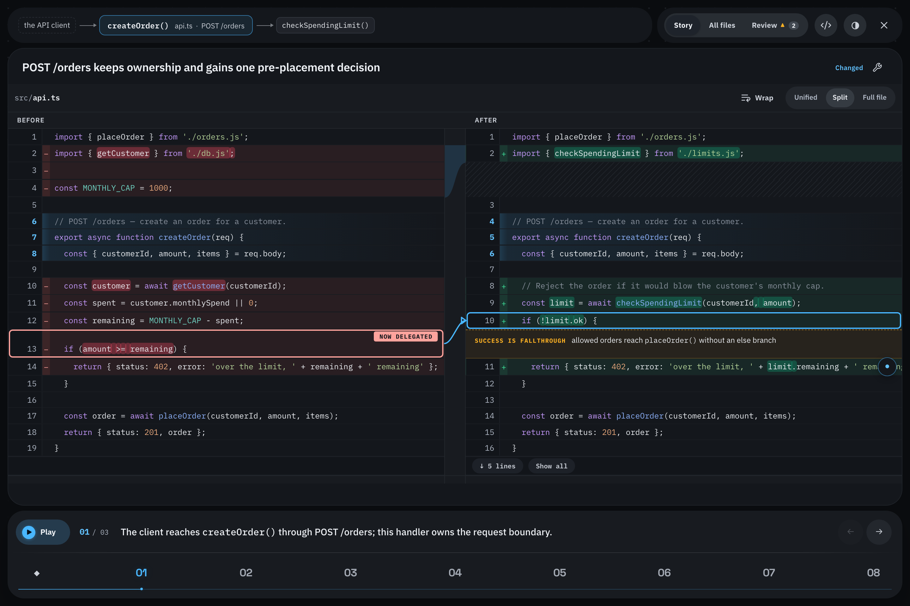
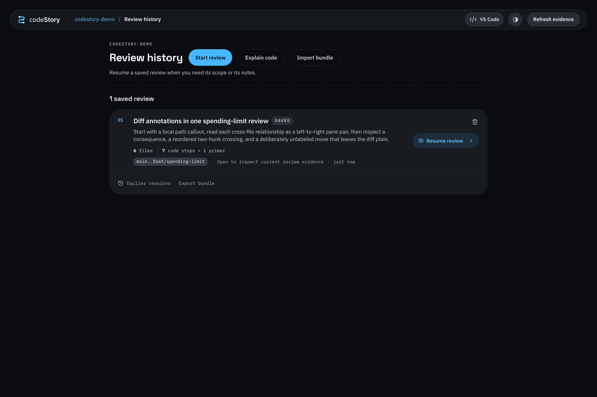
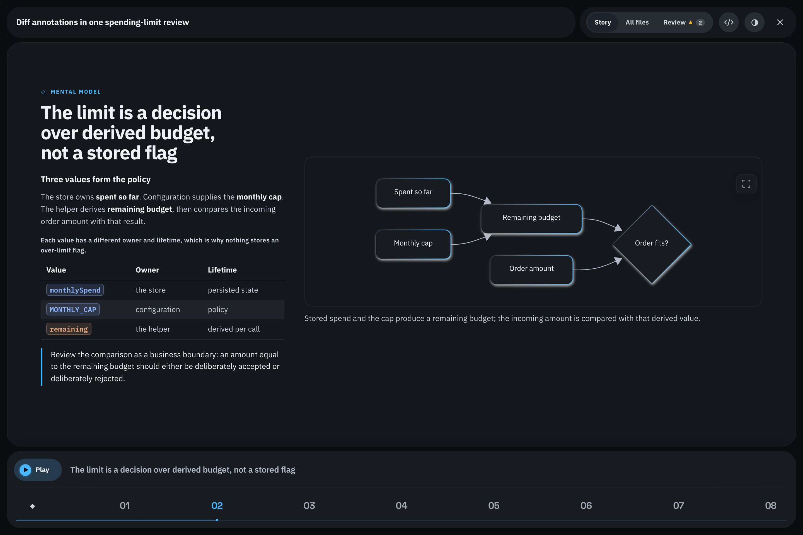

# codeStory

[](https://github.com/naveedinno/codeStory/actions/workflows/ci.yml)
[](LICENSE)

Read a code change in the order it actually makes sense.



codeStory is a local desktop app for reviewing git diffs. Open the app,
pick a repo, choose what changed, and review the real diff with an optional
AI-written walkthrough. When something needs work, select the exact text, add a
comment, then copy it or keep it in the review queue.

- Runs locally on your machine.
- Uses a proper desktop UI, not a terminal review flow.
- Works with plain git diffs, even without generating a story.
- Draws restrained boxes and arrows directly on split diffs when code genuinely
  moved, with accessible callouts only for facts neither pane can show.
- Can use Claude or Codex to generate and repair walkthroughs.
- Works without AI. Story-writing features are optional.
- Command-click or Ctrl-click a current-code identifier to open the reviewed
  repository in Zed or VS Code and reveal that exact source location.

## Quickstart

Build requirements:

- macOS
- Node.js 20 or newer
- Rust and Cargo
- git
- a local git repository you want to review

No Python is required for the core app.

Install the macOS app from a source checkout:

```sh
git clone https://github.com/naveedinno/codeStory.git
cd codeStory
./scripts/install-macos-app.sh
```

The installer installs locked Node dependencies, builds the server and browser
assets, and builds the native app. The first install needs network access to
download Node and Rust dependencies. Keep the source checkout in place: the app
runs its local server from that checkout.

Then open **codeStory** from Spotlight, Finder, or Launchpad. There is no
codeStory CLI and no terminal review workflow.

Optional: install Claude or Codex on your PATH if you want generated stories.

## Demo

Try a realistic throwaway review without touching your own repos:

```sh
git clone https://github.com/naveedinno/codeStory.git
cd codeStory
npm ci --include=dev
npm run demo
```

The demo creates a temporary git repo with a saved story, changed files, and a
couple of comments so you can see the full review loop.



## First Review

1. Make changes in any local git repo.
2. Open the **codeStory** app.
3. Pick a repo from **Choose your workspace**.
4. Choose what you want to review: uncommitted changes, the current branch, one
   commit, or any two refs.
5. Read the diff in **All files**, or open **Story** and generate a guided
   walkthrough.
6. Select exact text in the diff, right-click **Comment selected code**, choose
   **Fix request**, **Question**, or **Note**, and write the comment.
7. **Copy** is the default action and does not save anything. Use **Add to queue**
   when you want to keep the comment for the end of the review.
8. Open **Review → Comments** to edit or remove queued comments, jump back to
   their code, or use **Copy all** for one portable handoff.

You can use codeStory as a clean diff viewer without an agent. AI is only needed
when you want a generated or repaired story.

## What You See

The first screen is your project list.

- Recent repositories appear automatically after you open them once.
- **Add repository** lets you pick another local git repo.
- Missing or non-git folders are marked so you can remove them from recents.

Inside a repo, codeStory gives you two useful ways to read:

- **All files** shows the real git diff file by file.
- **Story** rebuilds the minimum app context around the task, then walks the
  existing entry point, changed decision, downstream effect, and proof in the
  order the logic flows—not alphabetically by filename. Each step frames the
  relevant surrounding code, including unchanged lines when they explain the
  boundary, and spotlights the exact evidence for each narration beat. When a
  change introduces a new term, lifecycle, or architectural boundary, the story
  can pause for a short **concept primer** before the code that depends on it.
  Primers are document steps with optional locally rendered Mermaid diagrams;
  they do not pretend to be files and do not count as diff coverage. In story
  version 4 a concept step can instead be a free HTML page (JavaScript allowed)
  rendered in a sandboxed frame; pages are offline unless they opt into network
  access, so see [the privacy notes](docs/story-schema.md#concept-pages-and-privacy).



The story never replaces the diff. It only explains and orders it. The code you
read comes from git.

## Code Stories

A story does not need a diff. Choose **Explain code** in Review history, ask what
you want to understand ("How does a quote become an open position?"), optionally
name the files or folders to start from, and pick the commit to explain. The agent
reads the code at that commit and writes a code story: the same guided reader,
spotlights, read-aloud, and concept pages, walking code that did not change.

- Leave the question empty for a guided tour of the whole codebase.
- A code story is pinned to one commit, so its line numbers never drift. When the
  files it visits change in your working tree, the Overview says so and offers
  **Rewrite at current code**.
- Code stories live under `.codestory/stories/code-*.json`, next to your diff
  stories in Review history, and never replace the live change story.
- Agents can write one directly: with the storyteller skill installed, ask Claude
  Code or Codex to explain the codebase, or one flow in it, as a codeStory.

## Review Workflow

codeStory keeps long reviews oriented and makes comments portable:

- **Inline comments** open directly beneath selected code—never in a modal. The
  exact selection is the anchor and travels with the comment.
- **Copy** is primary and one-shot: it copies the type, file, line range, diff
  side, selected code, and comment without writing to `.codestory/`.
- **Add to queue** is the only persistence action.
- **Review → Comments** groups queued comments by file. Edit or remove them,
  jump back to the code, or use **Copy all** when the review is ready.
- **Review** keeps coverage, queued comments, challenge checks, and explicit
  actions on one page.
- **Challenge** prioritizes author hotspots, permission checks, state changes,
  boundary cases, and regression tests across the story, with a reason for each
  suggested stop. These are review cues, not a correctness verdict.
- **Verification evidence** distinguishes reported test results from local runs.
  Use **Run locally…** to confirm and execute the displayed command in the
  checkout. A receipt records output, exit status, time, and source identity on
  this device; changing the source makes it out of date. Fixed-ref reviews can
  run checks only when the checkout matches the reviewed revision.
- **Caller evidence** exposes the source text behind a reported caller and can
  open its exact location in the source editor. A text match does not establish
  a call relationship or runtime reachability.
- **Since story → Refresh affected steps** updates changed explanations and
  connected steps. The app preserves existing IDs, independent steps, and the
  comment queue, then checks the full story before capturing a new baseline.
  An unsuccessful or interrupted refresh restores the previous story.
- **File search and filters** narrow the sidebar to seen or unseen files, files with
  comments, unexplained changes, tests, or files changed since your review.
- **Resume review** returns to the last file, line, and display mode on this
  device. **Next unseen** keeps a larger review moving.
- Select diff text to reveal the quick comment action. Press `C` to comment on
  the current selection, `/` to search files, or `?` for the command palette.
- A story step can be repaired in place: ask the agent to explain it, shorten
  it, or split it without regenerating the rest of the walkthrough.
- Open a story step to land on its first spotlight, then select any narration
  beat to move the highlight to the exact lines it explains. Read-aloud follows
  the same camera path automatically.

## Video Export

Choose **Export video** beside a saved story in Review history, or open a story
and choose **File → Export Video…** (⇧⌘E on macOS). Choose 1080p or 720p,
set the reading speed, and select **Create video**. Progress estimates the time
left for passage generation, then final encoding. The MP4 follows the overview,
concept pages, and every code spotlight, with an attached, selectable subtitle
track. Enable or disable subtitles in your player’s subtitle menu.
The video uses a slightly wider view and leaves out app navigation and playback
controls to give the story more room. Choose **Lino** in **Narration**, then
choose a **Voice model** and **Voice** directly in the export dialog, or choose the
**macOS system voice**. Lino generates the soundtrack locally without playing
it aloud or changing interactive narration settings. The export keeps the selected
model and voice throughout the video and applies its own reading speed.
Choose **None** for subtitles only. The export uses the current theme.

Export runs locally and requires Google Chrome or a Playwright Chromium install,
plus FFmpeg and ffprobe. On macOS, install the encoder with `brew install ffmpeg`.
Chromium can be installed with `npx playwright-core install chromium`. The dialog
shows any missing tools before starting. Custom executable paths can be set with
`CODESTORY_VIDEO_BROWSER`, `CODESTORY_FFMPEG`, and `CODESTORY_FFPROBE`.

The video captures the story and reviewed source together before rendering;
later edits do not change an export in progress. Review position and queued
comments stay untouched. Online resources in concept pages are omitted. You can
close the dialog while it exports and reopen it to download the MP4, or cancel
an active export. Keep the app running until the download finishes. Temporary
files are removed on cancellation, failure, or app shutdown; finished downloads
remain available for an hour. The exported file includes the code and
explanations displayed in the walkthrough.

## Agent Setup

The installer copies the bundled codeStory skills into the common agent skills
location. If the app says skills are missing or stale, use the **Update skills**
button in the browser.

Claude Code users can also install the plugin:

```text
/plugin marketplace add naveedinno/codeStory
/plugin install codestory@codestory
```

For Zed Agent, Codex, Cursor, and other agents that read local skills, you can
also install the skills from a clone:

```sh
git clone git@github.com:naveedinno/codeStory.git
cd codeStory
./scripts/install-skills.sh
```

If no agent is installed, codeStory still opens and still works as a local diff
viewer with the complete comment queue. Only story generation and repair are
unavailable until Claude or Codex is on your PATH.

## Zed Integration

The bundled Zed extension adds a local codeStory MCP server to the Zed Agent
panel. Its `codestory` prompt and `start_codestory` tool support `brief`,
`guided`, and `detailed` story modes. Install the storyteller skill, select Zed
for source jumps, and print the final extension-install step with:

```sh
./scripts/install-zed-integration.sh
```

Then open Zed's Extensions page, choose **Install Dev Extension**, select the
checkout's `zed-extension` directory, and enable the **codeStory** server in the
active Agent profile. Ask Zed Agent to “create a guided codeStory using
codeStory”, or select the `codestory` MCP prompt when the active Agent UI exposes
prompts.

Zed removed extension-provided slash commands and does not expose custom editor
panels or webviews to extensions, so this integration uses Zed's supported MCP
surface. The native codeStory desktop app remains the story player and review
canvas; source jumps connect it back to the exact Zed workspace and location.

## Jump To Source In Zed Or VS Code

Command-click on macOS or Ctrl-click elsewhere on an identifier in the
current-code side of a diff. codeStory opens the reviewed repository as the
active editor workspace, places the caret at the clicked location, and brings
that line into view.

Use the **Source editor** menu beside the theme control to choose Zed or VS Code.
The choice is saved immediately and is available from the repository picker,
repository navigation, and review toolbar. The Zed integration installer selects
Zed initially. You can also switch from a terminal with
`node scripts/set-source-editor.mjs zed` or
`node scripts/set-source-editor.mjs vscode`. VS Code retains its built-in
`vscode://file/…` fallback; Zed uses the CLI bundled with the stock app.

## Review Files

codeStory stores review state inside the repo you open:

```text
.codestory/story.json      generated reading order
.codestory/comments.json   local queued review comments
.codestory/review-state.json review rounds, snapshots, and timeline events
.codestory/stories/        optional saved named stories
```

By default, keep `.codestory/` local and add it to `.gitignore`.

If your team intentionally wants replayable walkthroughs, share a story file as
part of your review process and make that convention explicit. Comments are
normally local reviewer state.

## Team Use

If codeStory is in a private repository, each teammate needs normal GitHub access
first, the same as cloning the repo. Each teammate installs and opens the macOS
app; there is no CLI installation path.

A teammate can replay a walkthrough when they have:

1. the same branch or commit range checked out
2. access to the story file your team chose to share
3. the codeStory app installed locally

They open the app, pick the repo, and open the saved story. No agent is needed
just to read an existing walkthrough.

To share, use **Export bundle** under the story on the Review history page and
send the `.codestory.json` file; the teammate uses **Import bundle** on the
same page. Imported stories land under `.codestory/stories/` and never replace
the live story. Queued comments stay local and are never exported.

## From Source

Use this when you are developing codeStory itself:

```sh
git clone https://github.com/naveedinno/codeStory.git
cd codeStory
npm ci --include=dev
npm run dev
```

The app opens at `http://localhost:7777/`. If the browser does not open
automatically, open the printed URL yourself.

`npm install` and `npm ci` build `dist/` automatically through npm's `prepare`
hook. Include dev dependencies for source installs; they supply the compiler and
bundlers. Generated `dist/` files stay local. npm packages still ship the built
files, and installs directly from Git build them before packaging. If you disable
install scripts, run `npm run build` before starting the app.

That is the whole core setup. You do not need Python, Homebrew, Claude, or Codex
just to open the app and review diffs. Narration uses voices from the separate Lino app.

Useful development commands:

| Command | Use |
| --- | --- |
| `npm run dev` | Build and run the internal web server for development. |
| `npm run build` | Compile `src/` into `dist/`. |
| `npm run start` | Run the built internal development server. |
| `npm run demo` | Build and open a sample review. |
| `npm test` | Build and run the test suite. |
| `npm run check:zed` | Test and compile the Zed extension to WebAssembly. |

## Narration With Lino

codeStory narrates with [Lino](https://github.com/naveedinno/Lino)'s local
speech engine instead of shipping voice models of its own. Install Lino in
`/Applications` or `~/Applications`, download the English voices in Lino's
**Settings → Read Aloud**, then use **Play story** or a step's play button in
codeStory. Lino does not need to be open: on the first narration request
codeStory starts a private copy of Lino's bundled engine on a random loopback
port behind a one-time secret, and stops it when codeStory exits. The private
engine uses downloaded models offline, so loading a voice does not wait for
Hugging Face. Manage model downloads in Lino.

Choose **Voice** beside Play to select the narration model, voice, and playback
speed directly in codeStory. The picker lists Lino's real local models and
voices; models that need downloading or do not support English are disabled.
Changing settings stops the current passage and clears its prepared audio.
codeStory remembers your last voice for each model and restores your choices
after restarting, in `~/.codestory/narration.json`. Lino provides the speech
engine and model downloads; codeStory owns its narration settings and leaves
Lino's preferences untouched. Stories are read in English.
Transport retries reuse a request ID so they cannot restart the same passage.
Older Lino builds use the embedded launcher for compatibility. Set
`CODESTORY_LINO_APP=/path/to/Lino.app` to use a build somewhere else.

When Lino or its English voices are missing, or its engine will not start,
codeStory falls back to the browser's built-in voice (Web Speech) and says so
once, on the first play. Playback, pause, and beat highlighting work the same
way; pause replays the current beat from its start on resume. If the browser
has no speech synthesis either, codeStory says what to install. No model,
cache, or voice preference is stored by codeStory.

## Troubleshooting

**The app does not open**

Re-run `./scripts/install-macos-app.sh` from the source checkout, then open
**codeStory** from Spotlight, Finder, or Launchpad.

**A repo is not accepted**

The folder must be a git repository. Open the folder that contains `.git`, or
paste that path into the project picker.

**Story generation says skills are missing or stale**

Click **Update skills** in the app, or rerun:

```sh
./scripts/install-skills.sh
```

from a codeStory clone.

**No Claude or Codex is found**

Install one of them and make sure its command is available on your PATH. You can
still read diffs without an agent.

## How It Works

The codeStory desktop app starts its private local Node server and renders the UI. The server
reads your local git repository, renders the diff, stores review state in
`.codestory/`, and can ask Claude or Codex to generate or repair a story.

The app uses Node built-ins for its runtime server. It does not need a hosted
service, database, browser extension, or cloud account.

For the story schema and agent contract, see
[`skills/codestory-storyteller/SKILL.md`](skills/codestory-storyteller/SKILL.md).

## Contributing

See [CONTRIBUTING.md](CONTRIBUTING.md) for local setup, checks, and contribution
notes. The short version:

```sh
npm run check
```

Release maintainers should also read [docs/RELEASE.md](docs/RELEASE.md).

## License

codeStory is source-available under the
[PolyForm Noncommercial License 1.0.0](LICENSE).

Personal, hobby, research, testing, and other noncommercial use is allowed.
Commercial use requires a separate commercial license from naveedinno
<naveedinno@proton.me>. That includes embedding codeStory or a modified
version in a paid product, proprietary app, hosted service, client project,
internal company tool, or commercial workflow.

This is not an OSI open-source license because commercial use is reserved.
